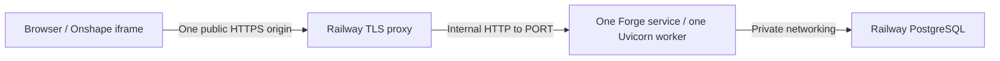

# Production hosting foundation

**DEPLOYMENT FOUNDATION IMPLEMENTED — NOT YET HOSTED**

This deployment track starts at `c10744b10d897ab9bd4ebb8b650b5d8ce39c1a9f`
on `deploy/railway-foundation`. Phase 9 and normal retained recovery V1 are frozen.
No Railway project/service, hosted database, credential, OAuth registration, scope,
Action URL or public app publication is created or changed by this phase.

## Reviewed starting boundaries

The starting application had no production SPA server, production Docker image,
Docker context policy, Railway configuration or hosted migration command. Vite
provided iframe headers only during development/preview; a frontend build alone
could not provide them on deployed HTTP responses. Settings accepted only the
psycopg SQLAlchemy URL scheme, whereas Railway's referenced PostgreSQL URL uses
`postgresql://`. These were the code/configuration blockers addressed here.

Existing controls remain: startup checks the exact Alembic revision before serving;
no schema creation/repair occurs at startup. Production requires HTTPS and complete
OAuth/database/encryption configuration, disables docs/OpenAPI, and uses Secure
host-only HttpOnly cookies. CSRF compares exact Origin (or Referer fallback) with
validated APP_BASE_URL. OAuth redirects also use that configured origin. Access
and HTTP transport logging are suppressed, and SQL parameters are hidden.
The Onshape bridge retains its exact standard-stack origin and parent-window
checks. AI provider keys stay backend-only; a missing selected provider key yields
unavailable AI, never simulated readiness. CAD writes default OFF.

Real hosting still requires provisioning, runtime secrets, private database
connectivity, ingress log review, backups, restore/rollback preparation and hosted
browser validation. Passing this foundation gate does not certify public multi-user
production readiness. See [SECURITY.md](SECURITY.md) for the remaining operational gates.

## Topology and request routing



One public Forge service serves the React production build and FastAPI on the same
exact HTTPS origin. There is no separate public frontend/API origin and no CORS
wildcard. PostgreSQL has no public domain or TCP proxy; use the private database
reference, never DATABASE_PUBLIC_URL. Start with a Railway-provided domain and
Railway-managed TLS; a custom domain is a later coordinated transition.

| Path                                | Handler                           |
| ----------------------------------- | --------------------------------- |
| `/`, `/extension`                   | Compiled React `index.html`       |
| `/assets/*`                         | Compiled hashed assets only       |
| `/brand/*`                          | Compiled public brand assets only |
| `/api/*`, `/auth/*`, `/health`      | Existing FastAPI routers          |
| Other paths, including docs/OpenAPI | 404 (no broad SPA fallback)       |

The UI uses hash navigation, so only the two explicit SPA entrypoints are needed.
Production uses exact route paths and disables slash redirects so framework redirects
do not echo auth queries or derive destinations from the incoming Host/scheme.
Query-bearing `/extension` serves HTML without redirecting or changing the query;
the existing browser launch parser still validates all fields. DEV UI lab,
simulator and diagnostics remain eliminated by the Vite production build.
StaticFiles rejects traversal and follows no escaping symlinks. No browser request
selects a filesystem root. Root HTML is no-store, as are existing API responses.

`WEB_BUILD_DIR` is a server-only, explicit absolute build directory; the image sets
it to `/app/web`. Production requires it. It must contain `index.html` and an
`assets` directory and contain no symlinks or parent-traversal components. Relative,
missing, incomplete and non-production static configurations fail closed. The
image application files are root-owned and the runtime user cannot rewrite them.
Development leaves this setting unset. `make dev`, the HTTP lab, local HTTPS
Onshape development and Vite's existing `/api`/`/auth` proxies remain unchanged.

## Headers, proxy and HTTPS boundary

Production app responses, including extension HTML, assets, handled errors and
404s, carry:

```text
Content-Security-Policy: frame-ancestors https://cad.onshape.com
Referrer-Policy: no-referrer
X-Content-Type-Options: nosniff
```

No other frame ancestor is permitted. Do not add X-Frame-Options DENY/SAMEORIGIN
at Railway, a CDN or another proxy: both conflict with Onshape embedding. Header
proof here covers responses produced by Forge; platform-generated errors must be
checked at the live ingress later. This frame policy does not replace postMessage,
authentication, object authorization or CSRF validation.

Railway terminates TLS; the container may receive HTTP. The canonical origin,
redirect destination, Secure cookie choice and CSRF comparison come from validated
HTTPS `APP_BASE_URL`, not the incoming scheme, Host, X-Forwarded-Proto,
X-Forwarded-Host or client IP. Request URL use in the boundary is path-only.
The launcher disables Uvicorn proxy-header interpretation altogether; no forwarding
source is trusted, and no application IP authorization/rate policy is introduced.
No HTTPS redirect middleware derives a destination from untrusted proxy metadata.

The launcher binds `0.0.0.0` to the supplied `PORT` (validated integer, default
8000 for local use), runs exactly one worker, and disables access logging.
Keep one Railway replica and do not add workers/multi-region/autoscaling yet:
access-token caches and several request gates are process-local, and write/recovery
coordination requires a separate scale review. Railway may briefly overlap old/new
deployments; writes remain OFF throughout this foundation and future rollout.
Ingress/APM logs must omit callback query strings, cookies, authorization headers,
request/response bodies and database URLs before real OAuth validation.

## Build and local verification

From the repository root:

```sh
make setup
make build
docker build --tag forge:railway-foundation .
make deployment-check
```

The multi-stage Dockerfile pins Node 24.21.0, Python 3.14.6 and uv 0.11.3 by
multi-platform manifest digest. The web stage uses `npm ci` and the existing npm
workspace lock. The Python stage uses `uv sync --frozen --no-dev
--no-install-project --no-editable --no-cache` with the existing uv lock. API source
is loaded through PYTHONPATH, avoiding an unlocked isolated package-build step.
No dependency or build backend is resolved at runtime. No credentials or VITE
configuration are needed at build time. Review and update image digests explicitly
when applying future security updates.

The final image contains the Python runtime/locked runtime environment, API source,
Alembic configuration/migrations and compiled web build. It excludes Node/npm/uv,
host node_modules, tests/fixtures, local env/certificates, Git metadata, caches and
local databases. It runs as UID/GID 10001 with root-owned application files.
The deny-by-default `.dockerignore` admits only required source/lock/config inputs
and applies sensitive-path exclusions again inside allowed source trees.

`make deployment-check` requires Docker and an already built image. It exports
and inspects the actual Docker context, checks nested synthetic exclusion canaries
using Docker's matcher, inspects final image metadata/filesystem and credential
patterns, and starts a disposable PostgreSQL 18 container on a disposable Docker network with loopback-only published ports.
It runs the exact pre-deploy migration twice, starts the image on a supplied PORT,
and checks health, SPA entrypoints/query, JS asset, headers, docs and reserved 404s.
It runs `make migration-check` against that disposable database and `make test`
with all opt-in PostgreSQL tests enabled. Synthetic credentials only; no OAuth,
AI or CAD calls. Only local HTTP probes and synthetic provider transports are used.
It removes only its own containers/network and temporary artifacts, including on
failure; it never touches existing Compose services or persistent volumes.

The full gate also requires `make format`, `make lint`, `make typecheck`,
`make build`, `make test-e2e`, `make compose-check` and `make audit`.
Automated verification is evidence for the tested scenarios, not a claim of live
integration success or security certification.

## Railway configuration and migrations

`railway.json` selects the root Dockerfile, one replica, `/health` with a 120-second
startup health timeout and ON_FAILURE restart policy capped at three retries.
The image CMD is the sole startup command. The pre-deploy command is:

```sh
alembic -c /app/api/alembic.ini upgrade head
```

[Railway pre-deploy commands](https://docs.railway.com/deployments/pre-deploy-command)
run with service variables on the private network; failure prevents deployment.
No seeding, downgrade, destructive reset or automatic schema-drift repair is added.
The API still verifies the exact revision on startup. `/health` remains process
liveness, not continuous database/provider readiness; it becomes reachable only
after the initial schema check succeeds. No migration is run by the image CMD.

Before provisioning, review the
[config-as-code reference](https://docs.railway.com/config-as-code/reference),
[healthcheck behavior](https://docs.railway.com/deployments/healthchecks), and
[private networking](https://docs.railway.com/networking/private-networking).
These service settings do not provision a database, domain, secret or backup.

## PostgreSQL URL strategy

Set the Forge service DATABASE_URL through the private Railway Postgres
DATABASE_URL reference. [Railway exposes both the URL and component variables](https://docs.railway.com/databases/postgresql).
Referencing the complete URL preserves provider escaping and password rotation;
reassembling user/password components in a template risks invalid URL encoding.

Settings deterministically rewrites only an exact `postgresql://` prefix to
`postgresql+psycopg://`, preserving encoded credentials and query options. An
already psycopg-formatted URL is unchanged. Parsing requires a host, database and
valid port, and rejects fragments/whitespace, malformed URLs, arbitrary schemes,
mysql, alternate PostgreSQL drivers and production sqlite. SQLite remains confined
to existing unit-test configuration. DATABASE_URL remains SecretStr, validation
errors redact inputs, and neither migrations nor checks print the URL.

## Hosted environment inventory (names only)

No runtime credentials are committed. Enter secrets through Railway runtime secret
management; never copy the local `.env`, use build arguments for secrets or add
VITE secrets. This inventory deliberately contains no environment-specific values.

| Variable                                              | Classification                                 | Responsibility                                                         |
| ----------------------------------------------------- | ---------------------------------------------- | ---------------------------------------------------------------------- |
| `ENVIRONMENT`                                         | REQUIRED NON-SECRET                            | Select production mode                                                 |
| `APP_BASE_URL`                                        | REQUIRED NON-SECRET                            | Exact public HTTPS Forge origin                                        |
| `WEB_BUILD_DIR`                                       | REQUIRED NON-SECRET                            | Image-defined validated static directory                               |
| `PORT`                                                | REQUIRED NON-SECRET                            | Railway-injected listening port                                        |
| `DATABASE_URL`                                        | REQUIRED SECRET                                | Private PostgreSQL service reference                                   |
| `TOKEN_ENCRYPTION_KEY`                                | REQUIRED SECRET                                | Primary backend encryption key                                         |
| `ONSHAPE_CLIENT_ID`                                   | REQUIRED NON-SECRET                            | Registered confidential OAuth client identifier; backend configuration |
| `ONSHAPE_CLIENT_SECRET`                               | REQUIRED SECRET                                | Backend OAuth client credential                                        |
| `ONSHAPE_REDIRECT_URI`                                | REQUIRED NON-SECRET                            | Exact callback at APP_BASE_URL                                         |
| `ONSHAPE_API_BASE_URL`                                | REQUIRED NON-SECRET                            | Reviewed standard-stack API endpoint (existing default)                |
| `SESSION_SAMESITE`                                    | REQUIRED NON-SECRET                            | Explicit hosted cookie policy; global default remains lax              |
| `FORGE_AI_PROVIDER`                                   | REQUIRED NON-SECRET                            | Explicit selected provider (existing default Groq)                     |
| `GROQ_API_KEY`                                        | REQUIRED SECRET for Groq; otherwise OPTIONAL   | Backend selected-provider key, needed for live AI only                 |
| `OPENAI_API_KEY`                                      | REQUIRED SECRET for OpenAI; otherwise OPTIONAL | Backend selected-provider key, needed for live AI only                 |
| `TOKEN_ENCRYPTION_PREVIOUS_KEYS`                      | OPTIONAL                                       | Secret backend decryption key ring during reviewed rotation            |
| `ONSHAPE_COMPANY_ID`                                  | OPTIONAL                                       | Reviewed enterprise policy; not enabled by this phase                  |
| `ONSHAPE_AUTHORIZATION_URL`, `ONSHAPE_TOKEN_URL`      | OPTIONAL                                       | Existing validated official endpoint defaults                          |
| `SESSION_LIFETIME_SECONDS`, `SESSION_IDLE_SECONDS`    | OPTIONAL                                       | Existing bounded session lifetimes                                     |
| `FORGE_GROQ_MODEL`, `FORGE_GROQ_REASONING_EFFORT`     | OPTIONAL                                       | Existing allowlisted model/effort settings                             |
| `FORGE_OPENAI_MODEL`, `FORGE_OPENAI_REASONING_EFFORT` | OPTIONAL                                       | Existing allowlisted model/effort settings                             |
| `FORGE_MODIFY_REASONING_EFFORT`                       | OPTIONAL                                       | Existing bounded planner effort                                        |
| `FORGE_CAD_WRITES_ENABLED`                            | MUST REMAIN FALSE/OFF                          | No CAD writes in this deployment track                                 |
| `FORGE_SAFE_EDIT_DIAGNOSTICS_ENABLED`                 | MUST REMAIN FALSE/OFF                          | Development diagnostics excluded                                       |
| `FORGE_CAD_WRITE_CONFORMANCE_PAUSE_SECONDS`           | MUST REMAIN FALSE/OFF                          | Development pause excluded; must stay zero                             |

The model aliases `FORGE_AI_MODEL` and `FORGE_AI_REASONING_EFFORT` remain supported
by existing Settings; prefer the explicit provider names and do not set conflicting
aliases. No selected AI key is required for a liveness/static smoke test.

## Embedded session and Onshape URL transition (later)

Hosted iframe validation may require `SESSION_SAMESITE=none`, which requires Secure
cookies over HTTPS. The global default stays `lax`. None does not guarantee iframe
compatibility: browser third-party-cookie restrictions/partitioning still apply.
Keep the existing separate-tab sign-in and session-check fallback. Never store or
relay credentials in browser storage or postMessage to bypass browser policy.

Onshape embedded UIs require HTTPS. Once the final origin has been selected, the
planned callback shape is:

```text
https://<final-forge-origin>/auth/onshape/callback
```

The planned extension Action URL shape is:

```text
https://<final-forge-origin>/extension?documentId={$documentId}&workspaceId={$workspaceOrVersionId}&elementId={$elementId}
```

Do not hardcode `server`: Onshape adds its default parameters, including server
metadata, and the existing strict launch parser validates them. Do not regenerate
OAuth credentials, modify scopes, change the live Action URL or publish the app
publicly in this phase. Hosted URL registration is a later authorized operation.

For a custom-domain move, provision/verify DNS and Railway TLS first, then coordinate
APP_BASE_URL, ONSHAPE_REDIRECT_URI, registered callback and Action URL in one
controlled transition. The old origin's host-only cookies do not transfer; users
must authenticate again. Do not add a second trusted CSRF origin, broad CORS or
forwarding-header trust as a shortcut. Keep writes OFF and recheck the actual
Onshape iframe, browser cookie behavior and headers at the new HTTPS origin.

## Rollout and rollback plan (not executed)

Before the first hosted migration, configure private Postgres, managed runtime
secrets, backup/restore verification and callback/ingress redaction. Pin the
reviewed application revision; keep automatic rollout disconnected until the
separate live-deployment authorization. Confirm the pre-deploy command and startup
schema check pass before routing traffic, then validate static/auth routing and
HTTPS headers without enabling writes. Real OAuth/AI/Onshape validation is a
separate step requiring the final registration and credentials.

For a failed migration or startup, leave the previous healthy deployment serving;
inspect sanitized fixed-code diagnostics. Never seed, downgrade, clear recovery
fences or repair schema drift automatically. Roll back application code only to a
revision compatible with the current database schema. This phase adds no migration
and uses the existing schema. For later schema changes use reviewed compatible
migrations; restore a tested backup only under a separate approved recovery plan.
An origin rollback must restore the matching callback/Action URL configuration and
requires fresh host-bound sessions. Database volumes are retained.

## Local gate evidence — 2026-10-22

The starting branch, HEAD, fetched origin/main and clean tree matched the requested
commit before creating `deploy/railway-foundation`. Locked npm/uv installs passed;
no dependency or lockfile changes were needed.

- `make format`, `make lint`, `make typecheck`, `make build`,
  `make compose-check` and `make audit` passed; audits reported no known vulnerabilities.
- `make test`: 827 frontend tests and 2,485 API tests passed, including all 42
  opt-in real-PostgreSQL cases, on a disposable database. No PostgreSQL skips.
- `make test-e2e`: 594 passed across Chromium, Firefox and WebKit.
- Docker builds passed for local ARM64 and Linux AMD64. Both images passed
  synthetic startup/PORT, health, SPA/query, asset, headers and reserved-route smoke.
- The reviewed Railway migration command ran twice on each disposable database;
  `make migration-check` passed. No live/existing database was migrated.
- Actual Docker context export, nested exclusion canaries and final runtime
  metadata/filesystem/credential-pattern inspection passed.

One existing missing-provider-key test was isolated from the developer's local
environment after the full gate exposed that assumption; provider behavior is
unchanged. All temporary services were removed, and the pre-existing local
PostgreSQL service was left untouched. Vite reports the existing bundle-size
advisory; it does not fail the build. No real integration call, Railway deployment,
Onshape registration change, CAD write or recovery change was performed.
